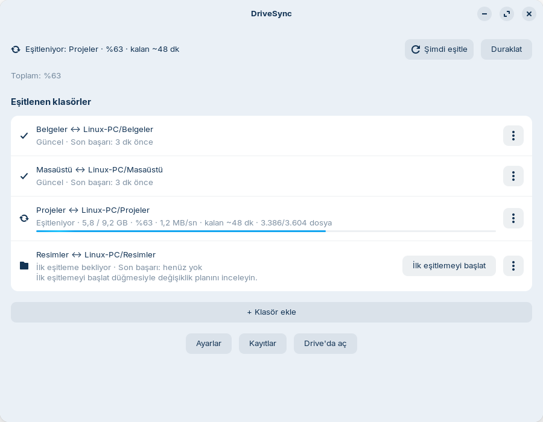
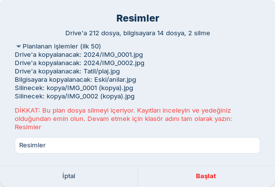

[Türkçe](README.md) | [English](README.en.md)

# DriveSync for Linux

DriveSync keeps selected local folders in **two-way sync** with Google Drive under
**My Drive / Linux-PC / your folder name / …**. It uses [rclone bisync](https://rclone.org/bisync/)
with a Python + GTK/libadwaita desktop interface. New installations start with **no folders configured**.
`Linux-PC` is configurable with `drivesync-cli config set root_folder "NAME"`. The application UI is available in English and Turkish;
this guide notes the labels you will see.

**Language / Dil:** the UI follows the system language (Turkish if it starts with `tr`, otherwise English).
Override it with `drivesync-cli config set language en` (or `tr`; `auto` is the default) or the
`DRIVESYNC_LANG=en` environment variable.

## Screenshots

The images use demo data only (the interface is Turkish).





## Set up with an AI agent

You can set up DriveSync with Codex, OpenCode, Claude Code, Gemini CLI or another coding agent:

```bash
git clone https://github.com/kocakburhan/drivesync-linux.git
cd drivesync-linux
```

Open the repository in your agent and paste this prompt:

> Set up Google Drive on my Linux computer using this repository. Follow the Setup Playbook in AGENTS.md and consult me at each step.

The agent follows [AGENTS.md](AGENTS.md) and manages folders/settings through the CLI.
**You still need to:** approve/provide the sudo password for system packages, sign in to Google and click
browser consent, and review and explicitly approve the first sync preview.
The agent can hand long initial uploads to the daemon (they survive reboot) and monitor progress.

## Features

- Tray, main window, notifications and live transfer progress.
- inotify monitors local changes and triggers sync after a short debounce; remote changes are polled.
- Nautilus approximate status emblems and context menu.
- Mandatory dry-run before first sync/resync, reviewable plan and typed folder-name confirmation for deletions in the GUI.
- Default 25% maximum deletion guard during normal sync.
- Newer version wins conflicts; Drive deletions use Drive trash by default.

## Requirements

Targeted/tested desktop: **Zorin OS 18 / Ubuntu 24.04, GNOME 46 (X11)**.
Requires Python 3.12, a systemd user session, a browser, a Google account and **rclone >= 1.66**.
Sync itself does not depend on X11. On Wayland, check tray/portal behavior and Nautilus rendering in your session;
other desktops such as KDE have not been separately validated.

Required packages match the code's GI checks: `python3-gi`, `gir1.2-gtk-3.0`,
`gir1.2-gtk-4.0`, `gir1.2-adw-1`, `gir1.2-notify-0.7`,
`gir1.2-ayatanaappindicator3-0.1`, `python3-nautilus`, `libnotify-bin`.
GTK 3 serves the tray; GTK 4 + Adw serve the window. `python3-nautilus` supplies the Nautilus 4.0 interface.

On vanilla Ubuntu GNOME, the tray requires **AppIndicator and KStatusNotifierItem Support**;
Ubuntu preinstalls it as `ubuntu-appindicators`. Check that it is enabled in Extensions.
You can open the main window from the application menu even without the tray.

## Installation step by step

Run commands in Terminal as your normal desktop user. Only system package installation requires sudo.

### 1. Install system packages

```bash
sudo apt update
sudo apt install python3-gi gir1.2-gtk-3.0 gir1.2-gtk-4.0 gir1.2-adw-1 gir1.2-notify-0.7 gir1.2-ayatanaappindicator3-0.1 python3-nautilus libnotify-bin git curl unzip
```

### 2. Choose an rclone installation method

Distribution packages may be too old. Version **1.66 or later** is required.

**Without sudo:** in step 3 use `./install.sh --with-rclone`. On Linux amd64/arm64 it downloads
the latest stable ZIP from `downloads.rclone.org`, verifies it against that release's `SHA256SUMS`
and installs only `~/.local/bin/rclone`. It never runs sudo; failed downloads/checksums preserve the existing binary.

**Alternative official system installer:**

```bash
sudo -v ; curl https://rclone.org/install.sh | sudo bash
```

This runs the official internet script with administrator privileges. If you choose it,
use plain `./install.sh` in step 3.

### 3. Clone and install DriveSync

```bash
git clone https://github.com/kocakburhan/drivesync-linux.git
cd drivesync-linux
./install.sh --with-rclone
export PATH="$HOME/.local/bin:$PATH"
drivesync-cli --version
```

Use `./install.sh` when a sufficiently recent rclone is already installed. Existing configuration is preserved;
the daemon and tray services are enabled. If your desktop PATH does not include `~/.local/bin`,
log out and back in; add the `export` line to `~/.profile` if necessary.
Check `rclone version` and `drivesync-cli status`. At this point a
“Google Drive bağlantısı kurulmamış” (Drive connection is not set up) message is expected.

### 4. Create your own Google Client ID

Follow the [click-by-click Google Client ID guide](docs/GOOGLE-CLIENT-ID.en.md).
Create a **Desktop app** client and download its JSON file. It is free; no billing account is needed.
Set the Google app to **In production**: refresh tokens for Drive access expire after 7 days in Testing.

### 5. Connect your Google account

Replace the filename below with the actual downloaded filename; do not type the `…` literally:

```bash
drivesync-cli setup-remote --client-json "$HOME/Downloads/client_secret_….json"
```

Select the right Google account in the browser and grant Drive access. For your own unverified app,
“Google hasn't verified this app” may appear; follow **Advanced → Go to … (unsafe)** in the guide.
Success says “Google Drive bağlantısı kuruldu ve erişim doğrulandı”.
The client JSON is copied to `~/.config/drivesync/google-client.json` with mode 0600;
rclone stores the authorization token in its own config. Never upload these files to GitHub.

### 6. Add a folder and start initial sync

1. Open **DriveSync** from the application menu or run `drivesync-app`.
2. Click **+ Klasör ekle** (Add folder), choose an existing local directory, check the Drive folder name and click **Ekle**.
3. Accept **İlk eşitlemeyi şimdi başlat?** (Start first sync now?), or click **İlk eşitlemeyi başlat** on the row.
4. Wait for the preview. It can create a missing empty destination folder on Drive but copies/deletes no files.
5. Review “Drive'a N dosya, bilgisayara M dosya, K silme” (N to Drive, M to this computer, K deletions)
   and expand the action list. If deletions are planned, type the exact folder name to enable Start.
   Cancel unexpected plans and check the source/destination paths.
6. Click **Başlat** (Start). Watch progress in the window or tray. Closing the window leaves the transfer running.
   Keep the computer on and remain logged in; logout/reboot can interrupt it.

Equivalent CLI commands (the example directory must already exist):

```bash
drivesync-cli folder add "$HOME/Documents" --remote-name Documents --json
drivesync-cli status
# Use the ID returned by folder add; here it is documents:
drivesync-cli init documents --dry-run --json
# After reviewing and approving the preview:
drivesync-cli init documents --yes   # handed to the daemon; survives reboot
drivesync-cli progress documents --json
```

First sync merges both sides; when the same filename differs, the newer version wins.
Make a separate backup before starting. Real init/resync requires a successful preview in the past 24 hours
for the same paths and filters. For resync, use `resync documents --dry-run`, then `resync documents --yes`,
or **Yeniden eşitle** in the window.

## Usage and settings

The window shows overall/folder status, live progress, recent conflicts, logs and settings.
Tray actions include **Şimdi eşitle** (Sync now), **Duraklat / Devam et** (Pause / Resume),
**Drive'da aç** (Open Drive), **Pencereyi aç** (Open window).
Pause prevents new automatic jobs; it does not cancel a running transfer.
Nautilus offers **DriveSync: Şimdi eşitle** and **DriveSync: Drive'da göster**;
the latter opens a Drive filename search. Emblems describe approximate local state; see [details](docs/NAUTILUS.md).

```bash
drivesync-cli status
drivesync-cli sync                 # all eligible folders
drivesync-cli sync documents       # one folder ID
drivesync-cli pause
drivesync-cli resume
drivesync-cli logs documents       # latest log path
```

**Ayarlar** (Settings) edits remote polling (default 5 minutes; a cheap Drive change check, with a full bisync only when Drive changed or every `full_sync_interval_minutes` = 60 minutes as a safety net), local debounce (10 seconds),
maximum deletion percentage (25%), a bandwidth limit (`bwlimit`: empty = unlimited; e.g. `1M`, `10M:off` for upload:download, or a timetable such as `08:00,1M 23:00,off`; a running transfer finishes with its old limit and the next run uses the new one, no resync needed),
switches to pause automatically on metered networks (default on) and on battery (default off) (no new sync starts while the condition holds, a running transfer finishes, work resumes by itself afterwards; independent of the manual pause) and excludes. Exclude changes stop automatic sync of initialized folders
until you review and run **Yeniden eşitle**. Use `drivesync-cli config get|set` for safe scalar settings and `config excludes list|add|remove` for excludes.
See [AGENTS.md](AGENTS.md) for allowed keys and JSON contracts, or the [schema](docs/SPEC.md) for advanced configuration.
Removing a folder from the list leaves local and Drive files intact.

## Safety and data

- First sync is never automatic. Init/resync requires a successful preview. DriveSync never automatically
  uses `--force` after the deletion guard trips.
- Normal two-way sync propagates deletions. rclone uses Drive trash by default; Google's trash retention is limited.
  Local deletions do not go to the desktop trash. Sync is not a substitute for independent backups.
  Do not disable Drive trash through rclone config or environment overrides.
- Conflicts keep the version with the newer modification time and delete the loser. Inspect logs for tied timestamps/special cases.
- Symlinks are skipped, as are native Google Docs/Sheets/Slides documents.
- Default excludes: `node_modules/`, `.venv/`, `venv/`, `__pycache__/`, `build/`, `dist/`, `.git/`,
  `*.tmp`, `*.swp`, `*~`, `.~lock.*`, `~$*`. Do not remove `.drivesync-check` access markers.
- Config: `~/.config/drivesync/config.json`. The client JSON and pre-replacement rclone backups live beside it.
  rclone tokens usually live in `~/.config/rclone/rclone.conf`; `rclone config file` shows the exact path.
- State: `~/.local/state/drivesync/state.json`. Logs: `~/.local/state/drivesync/logs/`
  (last 200 runs plus rotated `daemon.log`). Bisync data: `~/.local/share/drivesync/bisync/`.
  `XDG_CONFIG_HOME`, `XDG_STATE_HOME`, `XDG_DATA_HOME` override these roots.
  Logs can contain filenames/paths; remove personal data before sharing them.

## Troubleshooting

- **rclone missing/old:** check `rclone version`; use `./install.sh --with-rclone` or the official script.
  `--with-rclone` also selects the new local binary in existing configuration and preserves other settings.
  Restart with `systemctl --user restart drivesync`.
- **Remote missing:** `rclone listremotes` must contain `gdrive:`. Complete `setup-remote`.
  For another name, use `--remote NAME`; successful setup also selects it in DriveSync.
  The daemon detects fixes within approximately 30 seconds.
- **Expired token / invalid_grant:** publish your Google app as described in the [guide](docs/GOOGLE-CLIENT-ID.en.md),
  then authorize again: `drivesync-cli setup-remote --client-json "/actual/client.json" --replace --yes`.
  Existing remotes are refused without `--replace`; rclone.conf is backed up first.
- **“Google hasn't verified this app”:** use Advanced only for your own app. Testing refresh tokens with full Drive scope
  expire after **7 days**; Publish app avoids that limit and is separate from Google verification.
  Workspace administrators can restrict access.
- **Too many inotify watches:** polling remains available. Compare `max_monitors` with the kernel's
  `fs.inotify.max_user_watches`; see [watchers](docs/WATCHERS.md).
- **Nautilus menus/emblems missing:** close Files windows, run `nautilus -q` and open Files again.
  On GNOME 46 emblems can appear beside icons or filenames.
- **Preview/init failure:** open logs or use `drivesync-cli logs ID`. The daemon runs the initial sync and
  resumes it after a reboot; if the plan changed meanwhile the folder shows "Yeniden onay gerekiyor" - preview and approve
  again. Daemon logs: `journalctl --user -u drivesync`.
- **Daemon stopped / browser not opening:** use a normal graphical login, never sudo.
  Check `systemctl --user status drivesync` and `journalctl --user -u drivesync`.
  Set a working default browser and repeat setup if necessary.
- **Deletion blocked:** inspect paths and logs first. Only for intended deletions,
  `drivesync-cli force-sync ID --yes` bypasses the guard once after explicit approval of a fresh preview.

## Updating and uninstalling

From the repository directory:

```bash
git pull && ./install.sh
# Load the updated code when needed:
systemctl --user restart drivesync.service drivesync-tray.service
```

Wait for active transfers to finish before updating/restarting. Existing configuration is preserved.

```bash
./uninstall.sh          # keep config, state and bisync data
./uninstall.sh --purge  # also remove DriveSync config/state/bisync data
```

Local synced files and Drive data are **untouched**. Finish any running initial sync before uninstalling.
rclone and its own config remain installed. After purge, reinstalling requires a fresh preview/initial sync.

## License and contributing

[MIT](LICENSE) · Copyright (c) 2026 Burhan Koçak.
See [CONTRIBUTING.md](CONTRIBUTING.md) for development, offline tests and the PR checklist.
