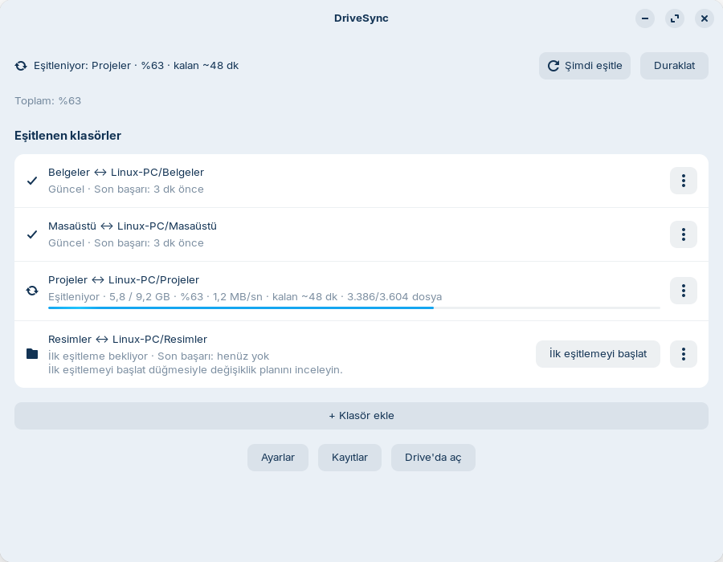
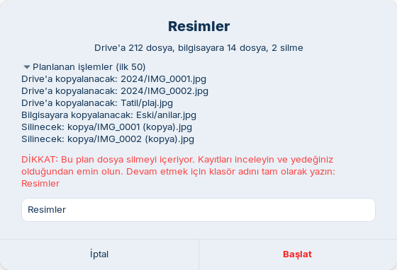

[Türkçe](README.md) | [English](README.en.md)

# DriveSync for Linux

DriveSync, seçtiğiniz yerel klasörleri Google Drive ile **iki yönlü** eşitler.
Dosyalar Drive'da **Drive'ım / Linux-PC / seçtiğiniz klasör adı / …** altında tutulur.
`Linux-PC` bilgisayar klasörünün varsayılan adıdır;
`drivesync-cli config set root_folder "AD"` ile değiştirilebilir. Eşitleme motoru [rclone bisync](https://rclone.org/bisync/),
masaüstü arayüzü Python + GTK/libadwaita'dır. İlk kurulumda hiçbir klasör seçili değildir.

## Ekran görüntüleri

Görüntülerde yalnızca örnek (demo) veriler vardır.





## Yapay zekâ asistanıyla kurulum

Codex, OpenCode, Claude Code, Gemini CLI veya başka bir kodlama ajanıyla kurulumu birlikte yapabilirsiniz:

```bash
git clone https://github.com/kocakburhan/drivesync-linux.git
cd drivesync-linux
```

Depoyu ajanınızda açın ve şu hazır isteği yapıştırın:

> Bu depoyu kullanarak Linux bilgisayarımda Google Drive'ı kur. AGENTS.md'deki kurulum adımlarını izle, her adımda bana danış.

Ajan [AGENTS.md](AGENTS.md) adımlarını izler; ayarlar ve klasörler CLI ile yönetilir.
**Sizin katılımınız gerekenler:** sistem paketleri için sudo onayı/parolası, Google hesabına giriş ve
tarayıcıdaki izin tıklamaları, ilk eşitleme önizlemesini inceleyip açıkça onaylamak.
Ajan uzun ilk aktarımı arka planda başlatıp ilerlemeyi kontrol edebilir.

## Özellikler

- Sistem tepsisi, ana pencere, bildirimler ve canlı aktarım ilerlemesi.
- Yerel değişiklikleri inotify ile izleyip kısa bekleme sonrası eşitleme; Drive değişikliklerini aralıklı kontrol.
- Nautilus'ta yaklaşık durum işaretleri ve sağ tık menüsü.
- İlk/yeniden eşitlemeden önce zorunlu dry-run ve incelenebilir özet; silmeler için GUI'de adla onay.
- Normal eşitlemede varsayılan %25 maksimum silme koruması.
- Çakışmada daha yeni sürüm kazanır; Drive'dan silinenler varsayılan olarak Drive çöp kutusuna gider.

## Gereksinimler

Hedeflenen ve test edilen masaüstü: **Zorin OS 18 / Ubuntu 24.04, GNOME 46 (X11)**.
Python 3.12, systemd kullanıcı oturumu, tarayıcı, kişisel Google hesabı ve **rclone >= 1.66** gerekir.
Wayland'da dosya eşitleme X11'e bağlı değildir; tepsi/portal ve Nautilus görünümünü kendi oturumunuzda kontrol edin.
KDE gibi diğer masaüstleri ayrıca doğrulanmadı. Uygulama Türkçe ve İngilizce arayüz sunar.

**Dil / Language:** Arayüz dili sistem diline göre seçilir (Türkçe değilse İngilizce). Değiştirmek için
`drivesync-cli config set language tr` veya `en` (`auto` varsayılandır); `DRIVESYNC_LANG=en` ortam değişkeni de çalışır.

Gerekli paketler, kodun GI sürüm kontrolleriyle eşleşir: `python3-gi`,
`gir1.2-gtk-3.0`, `gir1.2-gtk-4.0`, `gir1.2-adw-1`, `gir1.2-notify-0.7`,
`gir1.2-ayatanaappindicator3-0.1`, `python3-nautilus`, `libnotify-bin`.
GTK 3 tepsi, GTK 4 + Adw pencere içindir; `python3-nautilus` Nautilus 4.0 arayüzünü sağlar.

Vanilla Ubuntu GNOME'da tepsi için **AppIndicator and KStatusNotifierItem Support**
eklentisi gerekir; Ubuntu bunu `ubuntu-appindicators` olarak önceden getirir.
GNOME Uzantılar uygulamasında etkin olduğunu kontrol edin. Tepsi görünmese de uygulama menüsünden pencereyi açabilirsiniz.

## Kurulum adım adım

Komutları normal kullanıcı olarak Terminal'de çalıştırın. Yalnızca sistem paketi kurulumu sudo ister.

### 1. Sistem paketlerini kurun

```bash
sudo apt update
sudo apt install python3-gi gir1.2-gtk-3.0 gir1.2-gtk-4.0 gir1.2-adw-1 gir1.2-notify-0.7 gir1.2-ayatanaappindicator3-0.1 python3-nautilus libnotify-bin git curl unzip
```

### 2. rclone kurulum yöntemini seçin

Dağıtım paketindeki rclone eski olabilir. En az **1.66** gerekir.

**Sudo gerektirmeyen yöntem:** 3. adımda `./install.sh --with-rclone` çalıştırın.
Bu seçenek amd64/arm64 Linux için son kararlı ZIP'i `downloads.rclone.org` üzerinden indirir,
aynı sürümün `SHA256SUMS` dosyasıyla doğrular ve yalnızca `~/.local/bin/rclone` dosyasını kurar.
Sudo çalıştırmaz. Kontrol toplamı/indirme başarısızsa önceki rclone korunur.

**Alternatif, resmi sistem kurulumu:**

```bash
sudo -v ; curl https://rclone.org/install.sh | sudo bash
```

Bu komut resmi internet betiğini yönetici yetkisiyle çalıştırır. Bu yöntemi seçerseniz
3. adımda yalnızca `./install.sh` kullanın.

### 3. DriveSync'i indirin ve kurun

```bash
git clone https://github.com/kocakburhan/drivesync-linux.git
cd drivesync-linux
./install.sh --with-rclone
export PATH="$HOME/.local/bin:$PATH"
drivesync-cli --version
```

rclone zaten yeterince yeniyse `./install.sh` kullanın. Kurulum mevcut DriveSync yapılandırmasını korur;
arka plan servisini ve tepsiyi etkinleştirir. `~/.local/bin` oturumunuzun PATH'inde yoksa
çıkış yapıp tekrar giriş yapın; gerekirse yukarıdaki `export` satırını `~/.profile` dosyanıza ekleyin.
Kontrol: `rclone version` ve `drivesync-cli status`.
Henüz bağlantı kurulmadığı için bu aşamada “Google Drive bağlantısı kurulmamış” normaldir.

### 4. Kendi Google Client ID'nizi oluşturun

[Google Client ID: tıklama tıklama rehber](docs/GOOGLE-CLIENT-ID.md) sayfasını izleyin.
**Desktop app** istemcisi oluşturup JSON dosyasını indirin. İşlem ücretsizdir, faturalandırma gerekmez.
Google uygulamasını **In production** yapın; Testing durumunda Drive yetkisinin yenileme jetonu 7 gün sonra sona erer.

### 5. Google hesabını bağlayın

Aşağıdaki dosya adını indirdiğiniz gerçek JSON dosyasıyla değiştirin (`…` yazmayın):

```bash
drivesync-cli setup-remote --client-json "$HOME/Downloads/client_secret_….json"
```

Tarayıcı açılınca doğru Google hesabını seçip Drive erişimini onaylayın. Kendi doğrulanmamış
uygulamanız için “Google hasn't verified this app” çıkabilir: rehberdeki **Advanced → Go to … (unsafe)**
adımlarını okuyun. Başarıda “Google Drive bağlantısı kuruldu ve erişim doğrulandı” yazılır.
İstemci JSON'u `~/.config/drivesync/google-client.json` konumuna 0600 izinleriyle kopyalanır;
yetki jetonunu rclone kendi yapılandırmasında saklar. Bunları GitHub'a yüklemeyin.

### 6. Klasör ekleyin ve ilk eşitlemeyi başlatın

1. Uygulama menüsünden **DriveSync**'i açın (veya `drivesync-app`).
2. **+ Klasör ekle** ile gerçek bir yerel klasör seçin. Drive alt klasör adını kontrol edin ve **Ekle**'ye basın.
3. **İlk eşitlemeyi şimdi başlat?** sorusunu kabul edin veya satırdaki **İlk eşitlemeyi başlat** düğmesine basın.
4. Plan hazırlanırken bekleyin. Önizleme Drive'da eksikse boş hedef klasörü oluşturur; dosya kopyalamaz/silmez.
5. “Drive'a N dosya, bilgisayara M dosya, K silme” özetini ve açılır işlem listesini inceleyin.
   Silme varsa klasör adını tam yazarak onaylayın. Beklenmeyen işlem varsa **İptal**'e basın ve yolları kontrol edin.
6. **Başlat**'a basın. İlerlemeyi pencereden veya tepsiden izleyin. Pencereyi kapatmak aktarımı durdurmaz.
   Bilgisayar açık ve kullanıcı oturumu açık kalmalıdır; çıkış/yeniden başlatma aktarımı kesebilir.

Aynı işlemin CLI karşılığı (örnek klasörün mevcut olduğundan emin olun):

```bash
drivesync-cli folder add "$HOME/Documents" --remote-name Documents --json
drivesync-cli status
# folder add çıktısındaki kimliği kullanın; örnekte documents:
drivesync-cli init documents --dry-run --json
# Önizlemeyi inceleyip onayladıktan sonra:
drivesync-cli init documents --yes   # servise iletilir; yeniden başlatmada devam eder
drivesync-cli progress documents --json
```

İlk eşitleme iki taraftaki dosyaları birleştirir; aynı adlı farklı dosyalarda daha yeni sürüm tutulur.
Başlamadan önce ayrı bir yedek alın. CLI gerçek işlem için aynı yollar/filtrelerle son 24 saatte başarılı önizleme ister.
Yeniden eşitlemede `resync documents --dry-run`, ardından `resync documents --yes` kullanılır;
pencerede aynı işlem **Yeniden eşitle** düğmesidir.

## Kullanım

Pencerede genel/klasör durumu, canlı ilerleme, son çakışmalar, kayıtlar ve ayarlar bulunur.
Tepsiden **Şimdi eşitle**, **Duraklat / Devam et**, **Drive'da aç**, **Pencereyi aç** kullanılabilir.
Duraklatma çalışan aktarımı iptal etmez; yeni otomatik işleri durdurur.
Nautilus sağ tık menüsünde **DriveSync: Şimdi eşitle** ve **DriveSync: Drive'da göster** vardır;
ikincisi dosya adıyla Drive araması açar. Durum işaretleri yaklaşık yerel bilgidir; [ayrıntılar](docs/NAUTILUS.md).

```bash
drivesync-cli status
drivesync-cli sync                 # uygun tüm klasörler
drivesync-cli sync documents       # yalnızca bu kimlik
drivesync-cli pause
drivesync-cli resume
drivesync-cli logs documents       # son kayıt dosyası yolu
```

**Ayarlar**: Drive kontrol sıklığı (varsayılan 5 dakika; bu kontrol ucuzdur, tam eşitleme yalnızca Drive'da değişiklik görülürse ya da her `full_sync_interval_minutes` = 60 dakikada bir yapılır), yerel değişiklik beklemesi (10 saniye),
maksimum silme oranı (%25), bant genişliği sınırı (`bwlimit`: boş = sınırsız; `1M`, `10M:off`, `08:00,1M 23:00,off` gibi; eşitleyen işlem eski sınırla biter, yeni sınır sonraki eşitlemede geçerli olur, yeniden eşitleme gerekmez),
"Kotalı ağda otomatik duraklat" (varsayılan açık) ve "Pilde otomatik duraklat" (varsayılan kapalı) anahtarları (otomatik duraklamada yeni eşitleme başlamaz, çalışan aktarım biter; koşul kalkınca kendiliğinden devam eder; elle duraklatmadan bağımsızdır), hariç tutmalar. Hariç tutmalar değişince başlatılmış klasörlerde
ilk fırsatta **Yeniden eşitle** gerekir; otomatik eşitleme güvenlik için durur.
Ajanlar ayarlar için `drivesync-cli config get|set`, hariç tutmalar için `config excludes list|add|remove`
kullanmalıdır. İzin verilen anahtarlar ve JSON çıktıları: [AGENTS.md](AGENTS.md). Gelişmiş yapılandırma: [şema](docs/SPEC.md).
Klasör satırını listeden çıkarmak iki taraftaki dosyaları silmez.

## Güvenlik ve veri

- Yeni klasörler otomatik olarak ilk eşitlemeye alınmaz. Başarılı önizleme olmadan init/resync çalışmaz.
  Silme sınırı durdurduğunda uygulama kendiliğinden `--force` kullanmaz.
- Normal iki yönlü eşitlemede silmeler karşı tarafa da yansır. Drive tarafında rclone'un varsayılan
  çöp kutusu kullanılır; Google'ın çöp kutusu saklama süresi sınırlıdır. Yerel silmeler masaüstü çöp kutusuna gitmez.
  Eşitleme ayrı bir yedek yerine geçmez. `rclone.conf` veya ortam değişkeniyle çöp kutusunu kapatmayın.
- Çakışmada değiştirilme zamanı daha yeni kopya kazanır, kaybeden silinir. Eşit zaman/özel durumları kayıtlarla inceleyin.
- Sembolik bağlantılar izlenmez. Google Docs/Sheets/Slides gibi yerel dosya olmayan Google belgeleri atlanır.
- Varsayılan hariç tutmalar: `node_modules/`, `.venv/`, `venv/`, `__pycache__/`, `build/`, `dist/`, `.git/`,
  `*.tmp`, `*.swp`, `*~`, `.~lock.*`, `~$*`. `.drivesync-check` erişim dosyasını silmeyin.
- Yapılandırma: `~/.config/drivesync/config.json`; istemci JSON'u ve değiştirme öncesi rclone yedekleri aynı dizinde.
  rclone jetonları genellikle `~/.config/rclone/rclone.conf` içindedir (`rclone config file` kesin yolu gösterir).
- Durum: `~/.local/state/drivesync/state.json`; günlükler: `~/.local/state/drivesync/logs/`
  (son 200 çalışma, döndürülen `daemon.log`); bisync kayıtları: `~/.local/share/drivesync/bisync/`.
  `XDG_CONFIG_HOME`, `XDG_STATE_HOME`, `XDG_DATA_HOME` ayarlandıysa karşılık gelen kökler kullanılır.
  Günlükler dosya adları/yollar içerebilir; paylaşmadan önce kişisel bilgileri temizleyin.

## Sorun giderme

- **rclone bulunamadı/eski:** `rclone version`; `./install.sh --with-rclone` veya resmi betikle güncelleyin.
  `--with-rclone` yeni yerel ikiliyi mevcut yapılandırmada da seçer; diğer ayarlar korunur. `systemctl --user restart drivesync` ile tekrar kontrol edin.
- **Google Drive bağlantısı kurulmamış:** `rclone listremotes` içinde `gdrive:` olmalı.
  `setup-remote` adımını tamamlayın. Özel ad için `--remote AD` kullanın; başarılı kurulum bu bağlantıyı DriveSync içinde de seçer.
  Düzeltme daemon tarafından yaklaşık 30 saniyede algılanır.
- **Jeton süresi doldu / invalid_grant:** Google uygulamasını [rehbere](docs/GOOGLE-CLIENT-ID.md) göre yayınlayın;
  sonra `drivesync-cli setup-remote --client-json "/gerçek/istemci.json" --replace --yes` ile tekrar yetki verin.
  Mevcut bağlantı `--replace` olmadan değiştirilmez; önce rclone.conf yedeklenir.
- **“Google hasn't verified this app”:** yalnızca kendi oluşturduğunuz uygulama için rehberdeki Advanced adımını kullanın.
  Testing durumda tam Drive kapsamlı yenileme jetonları **7 gün** sonra sona erer; Publish app bunu önler,
  Google doğrulamasıyla aynı işlem değildir. Workspace yöneticileri erişimi kısıtlayabilir.
- **Çok fazla inotify izleyicisi:** uygulama aralıklı kontrole döner; veri eşitlemesi sürer.
  `max_monitors` ve sistemin `fs.inotify.max_user_watches` sınırını karşılaştırın; [izleme rehberi](docs/WATCHERS.md).
- **Nautilus menüsü/işaretleri yok:** açık Dosyalar pencerelerini kapatın, `nautilus -q` çalıştırıp tekrar açın.
  GNOME 46'da işaretler simgenin veya dosya adının yanında olabilir.
- **Önizleme/ilk eşitleme hatası:** pencere kayıtlarını veya `drivesync-cli logs KİMLİK` yolunu inceleyin.
  İlk eşitleme servis tarafından yürütülür ve yeniden başlatmadan sonra otomatik devam eder; plan
  değiştiyse "Yeniden onay gerekiyor" görünür, önizlemeyi yeniden onaylayın. Ayrıntı için `journalctl --user -u drivesync`.
- **Servis çalışmıyor / tarayıcı açılmıyor:** normal grafik kullanıcı oturumunda çalışın, sudo ile başlatmayın.
  `systemctl --user status drivesync` ve `journalctl --user -u drivesync` çıktısını kontrol edin.
  Varsayılan tarayıcınızı ayarlayıp `setup-remote` komutunu tekrar çalıştırın.
- **Silme engellendi:** kaynak/hedef yollarını ve kayıtları inceleyin. Yalnızca planladığınız silmelerse
  `drivesync-cli force-sync KİMLİK --yes` açık onaydan sonra korumayı bir kez aşar; rutin çözüm olarak kullanmayın.

## Güncelleme ve kaldırma

Depo dizininde:

```bash
git pull && ./install.sh
# Gerektiğinde yeni kodun yüklenmesi için:
systemctl --user restart drivesync.service drivesync-tray.service
```

Aktarım sürerken güncelleme/yeniden başlatma yapmayın. Mevcut config korunur.

```bash
./uninstall.sh          # config, durum ve bisync verisini korur
./uninstall.sh --purge  # DriveSync config/durum/bisync verisini de kaldırır
```

Drive ve yerel eşitlenen dosyalar **silinmez**. Sürmekte olan ilk eşitlemeyi kaldırmadan önce
tamamlayın. rclone ikilisi ve kendi yapılandırması korunur.
Purge sonrası tekrar kurulumda önce yeni bir dry-run/ilk eşitleme gerekir.

## Lisans ve katkı

[MIT](LICENSE) · Copyright (c) 2026 Burhan Koçak.
Geliştirme, çevrimdışı testler ve PR kontrol listesi: [CONTRIBUTING.md](CONTRIBUTING.md).
